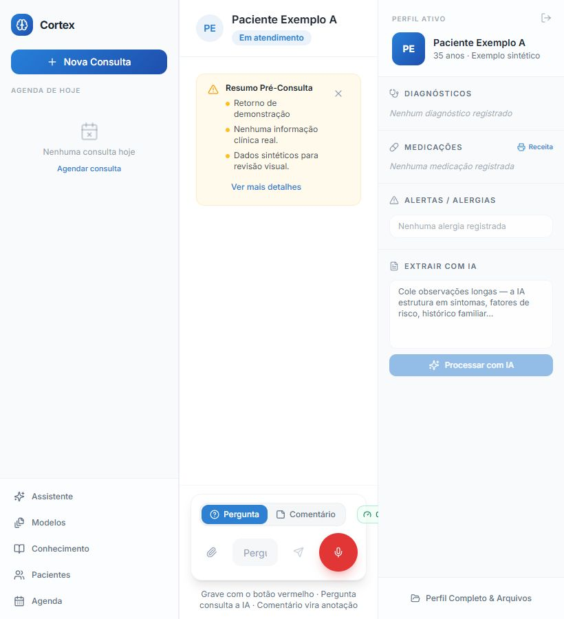

# Cortex: complete application review and Haddad Nicola launch map

**Implementation follow-up:** the authorized local fixes, clinic functions, brand update and verification are recorded in [remediation/IMPLEMENTATION.md](remediation/IMPLEMENTATION.md). The findings and evidence below remain the original review record. Provider selection and PersonalMed migration are deferred by the user.

**Review date:** 2026-10-28, America/Sao_Paulo. **Baseline:** `1ad2116`, local branch `codex/app-audit-remediation`. Application implementation was not changed by this review.

**Assessment:** Cortex has a useful physician-documentation foundation, but it is not ready for the requested clinic launch yet. The most valuable next work is reliable patient/encounter identity, complete physician acceptance of AI-derived facts, controlled sharing between doctors, and a permitted AI-provider configuration. Additional specialty functions should build on those foundations.

Read alongside the [delivery roadmap](ROADMAP.md) and [AI API comparison](AI_PROVIDER_OPTIONS.md). Detailed evidence and file/line references are in the [security review](security-review.md), [clinical workflow review](workflow-review.md), and [UX/accessibility review](ux-review.md).

## Scope and launch assumptions

The user confirmed that **all doctors** at Haddad Nicola will use the app, with **separate patient lists and optional explicit patient sharing**. The clinic currently uses **PersonalMed 2005**; data has been downloaded, but migration is a later task. This review did not locate, open, upload or process those exports. Reception access, billing replacement and a patient portal are not assumed to be first-launch requirements.

The clinic's public pages describe gynecology, obstetrics and urology in Curitiba. That supports specialty-specific templates and longitudinal workflows. Current staffing and operational volume were not independently verified. Direct page fetches were intermittently unavailable; the clinic context came from indexed versions of the official [services](https://haddadnicola.com.br/servicos/) and [about](https://haddadnicola.com.br/sobre-nos/) pages. No contact with the clinic was made.

Reviewed routes: authentication/recovery, main workspace, patient directory, calendar, Google callback, privacy/export/deletion, templates, knowledge library, general assistant, About and error handling. Reviewed backend areas: all 22 Edge Function type checks; Auth/RLS/Storage boundaries; clinical drafts and finalization; file analysis; prescriptions; OAuth/calendar/reminders; quotas; retrieval; data lifecycle; migrations and CI. Runtime inspection used only a loopback synthetic backend, including desktop/tablet/mobile workspace and mobile navigation.

## What is already useful

- The prior remediation introduced canonical object paths, owner checks, stronger SQL relationships, one-use OAuth state/PKCE, atomic quota admission, protected prescription lifecycle, revision-aware clinical changes and recoverable server drafts.
- Core functionality spans patient context, recording/transcription, SOAP review, history, documents, calendar, knowledge retrieval and privacy operations. This is a meaningful application base rather than a collection of disconnected screens.
- Query failures are handled explicitly in many important flows; record lists are fetched through ordered pages; heavy routes are lazy-loaded; CI runs type, test, database, build and dependency checks.
- Existing tests pass, but the new probes show why passing tests do not establish complete clinical or lifecycle safety. The previous report's closed findings should not be read as proof that no related path still needs review.

## Findings that affect the launch decision

P0 below means an immediate **launch decision gate**, not a demonstrated exploit. P1 means a high-priority patient-data or correctness defect to repair before the relevant real-patient workflow. P2 items belong in the planned reliability/usability work. Evidence types distinguish runtime reproduction, deterministic source traces and configuration still awaiting verification.

| Priority / reference | Finding | User impact | Evidence |
|---|---|---|---|
| **P0 · SEC-01** | Current Gemini Developer API configuration conflicts with clinical-use restrictions | Billing or a disclaimer alone does not establish eligibility for the intended clinical launch | Actual configured endpoint + current official terms; see AI_PROVIDER_OPTIONS.md |
| **P1 · UX-01** | A stale `?patient=A` URL can reselect A after the doctor has switched to B | A routine query refresh changes the active clinical context unexpectedly | Desired-behavior component test fails; retained [reproduction](ux-route-repro.txt) |
| **P1 · SEC-02** | Discard deletes draft metadata before confirming audio deletion | Failed cleanup can leave an audio object that later patient deletion cannot discover | Deterministic source trace across discard and patient deletion |
| **P1 · SEC-03** | Attachment analysis promotes AI-extracted claims into clinical notes automatically | Unreviewed extraction becomes chart context | Source trace from attachment action through service RPC |
| **P1 · W3** | Finalization runs a second extraction and writes unseen medical/social history | Approving SOAP does not approve the newly generated history | Actual handler with synthetic model/DB boundaries reproduced the write |
| **P1 · W2** | One completed encounter marks all same-day appointments for that patient completed | A later visit can disappear from the pending workflow | Actual handler probe with two same-day appointments and controls |
| **P1 · W1** | Blank optional age is saved as0 | Unknown demographics are represented as a newborn in clinical context | Actual component probe |
| **P1 · UX-02** | Patient-directory editing omits the revision check used elsewhere | Two tabs/sessions can overwrite newer demographics silently | Source-confirmed full-form update by ID only |
| **P1 · W4** | Assistant retrieves only five recent visits/eight files but may imply complete chart knowledge | An older existing result may be described as not attached | Deterministic retrieval limits and prompt instruction; live model wording not tested |
| **P1 · SEC-04** | AI template generation can retain patient identifiers and activates without review | Reusing a template can contaminate another patient's document | Source-confirmed missing acceptance/deidentification boundary; no actual leak observed |

The configured Gemini API's terms prohibit clinical-practice use; Google's standard Cloud generative-AI terms also restrict clinical purposes. Neither paying for the existing API nor simply changing to Vertex establishes permission. [Gemini API terms](https://ai.google.dev/gemini-api/terms), [Google Cloud terms](https://cloud.google.com/terms/service-terms)

## Remaining correctness, privacy and UX work

| Reference | Priority | Finding / improvement | Recommended outcome |
|---|---|---|---|
| SEC-05 | P2 | Fetch timeout ends at response headers | Deadline includes bounded body reading and cancellation; synthetic stalled-body reproduction confirmed the gap |
| SEC-06 | P2 | Validation manifest reads current prescriber settings | Immutable issuer/content snapshot agrees with the original document after profile changes |
| SEC-07 | P2 | Provider file cleanup and deletion wording do not match | Exact external object cleanup/retry and truthful receipts for provider/backup retention |
| SEC-08 | P2 | Export can miss/change rows while concurrent writes shift offsets | Define point-in-time semantics; server export job with stable manifest, resumability and checksums |
| SEC-09 | P2 | Missing frontend configuration falls back to a real project | Explicit environment validation, isolated previews and no implicit real-backend selection |
| W5 | P2 | Certificate duration is accepted then silently clamped | UI/API reject invalid values for correction; requested duration cannot silently change |
| W6 | P2 | Registration/scheduling/import can invent a last visit | Separate registration, scheduled and completed-encounter dates; preserve unknown history |
| W7 | P2 | Google create retry can duplicate an event after partial failure | Stable provider identity/outbox, visible retry and reconciliation |
| UX-03 | P2 | Dirty-form guards differ across close, Back and reload | Consistent save/discard/stay behavior across all editors |
| UX-04 | P2 | Completed/past visits can still receive ordinary reminders | One lifecycle/time-window policy in UI and server; follow-up is a separate action |
| UX-05 | P2 | Patient/catalog lookup errors look empty | Explicit failed/loading/empty states with preserved search and retry |
| UX-06 | P2 | Several enabled text/background combinations fail contrast targets | Correct semantic colors and verify rendered states; normal text target 4.5:1 |
| UX-07 | P2 | Status/input-mode/active-view state is visual only | Text/status semantics and accessible selected states |
| UX-08 | P2 | Local navigation can hide ongoing recording controls | Persistent patient-linked recording indicator/timer/action |
| UX-09 | P2 | Preview controls and copy/print failure paths are incomplete | Named/localized controls, associated descriptions and actionable fallback |
| UX-10 | P2 | Tablet three-column workspace compresses the composer | Collapse context/navigation before reducing the clinical input to an unusable width |

At 820×900 the question field measured **66px** wide and the usage chip was cropped. The 390×844 mobile arrangement was more usable in the synthetic scenario. This is a specific layout finding, not a full mobile-device certification.

## Functionality map and product opportunities

| Area | Present today | Strongest improvement | New capability worth adding |
|---|---|---|---|
| Identity/access | Individual accounts and owner-scoped records | Correct unknown demographics, persistent patient identity, MFA/session protection | Private doctor lists + explicit revocable patient grants with attributed contributions |
| Preparation | Snapshot, prebriefing, medications/allergies | Source/freshness/coverage indicators and approved facts | Previsit intake and a patient timeline after the core launch |
| Consultation | Recording, transcript, review, durable draft | Direct editing, consistent acceptance, visible capture status | Manual typed encounter and central pending-work queue |
| Clinical history | Notes, files, consultation history, revisions | Complete source-linked retrieval and conflict handling | Revision comparison, structured observations and medication lifecycle |
| Documents | Prescriptions, certificates, exam requests, summaries | Exact issuance metadata, reviewable templates, reliable archive | Versioned patient instructions and conditional verified signature integration |
| Scheduling | Local calendar, Google sync, reminders | Link appointment to encounter; meaningful reminder/sync state | Confirmation ledger, availability and waitlist later |
| Knowledge | Pasted documents, indexing, retrieval | Inspect original text, cite version, retry/retract | Clinician-reviewed shared protocols with separate permissions from patient charts |
| Specialty fit | Generic and several specialty prompts | Separate gynecology/prenatal/urology templates; urology currently missing | Pregnancy episodes and longitudinal result tracking |
| Follow-up | Return labels and AI pending text | Turn clinician-approved plans into explicit work | Assigned result/referral/follow-up tasks with due dates and review status |
| Portability | CSV registration import and account export | Source IDs/ownership, export jobs and restore drills | Later PersonalMed 2005 migration with dry-run reconciliation and reversible batches |

For the clinic's initial release, prioritize private/shared ownership, dependable documentation and recovery over expanding into billing, a patient portal or autonomous medical recommendations. Scope AI as a physician-controlled documentation aid while separately assessing more consequential clinical functions.

## Architecture, performance and maintenance

**Authorization is the largest new architectural requirement.** The current owner-ID checks are valuable but cannot simply be loosened for sharing. Introduce explicit grants and distinguish owner, author and actor. Apply revocation to SQL, Storage, Edge Functions, retrieval, caches and delayed jobs. Offboarding must preserve retained authored records; read/contribute must not imply whole-chart export, re-sharing or deletion. The roadmap specifies negative tests and a proposed access matrix.

**Pagination currently protects completeness, not bounded screen loading.** `Index.tsx:84–94` loads every patient's full row using `select('*')`; `fetchAllRows` continues until empty. Several screens paginate the displayed result only after fetching all rows. For a later PersonalMed import, move directory search/counts to server queries, use bounded cursor pages and fetch full clinical detail for the selected patient. Keep complete pagination for exports where appropriate. Benchmark with realistic record counts before setting performance targets.

**Keep the existing stack.** There is no evidence here that a framework rewrite would solve the identified problems. Separate the large consultation orchestrator into capture/draft/review/document operations with explicit patient/encounter identities. Decompose only along tested state transitions; do not scatter the same state into more files.

**Operational visibility is incomplete.** Add correlation IDs, provider/model versions, latency/error/cleanup metrics, retry states and incident runbooks without logging patient names, transcripts or document contents. Add a provider kill switch, synthetic health checks and restore drills. Daily quota admission is not a complete rate-limit or abuse-control strategy.

**Documentation and claims need reconciliation.** README still says Node20+, describes an old `process-consultation` deployment command and bidirectional calendar sync; package.json requires Node≥22.12 and current sync is not a complete inbound conflict/reconciliation system. Public About/Auth copy also needs an evidence review for speed, time-saving, regional hosting and privacy assertions. Replace unsupported promises with tested behavior and the actual contracted data flow. This is a launch communication issue, not evidence that a particular hosting setting is wrong.

**Testing should target clinical invariants.** The high-value missing cases are patient switching after refresh, multi-author edits, all AI acceptance paths, multiple same-day appointments, cleanup failures, grants revoked during work, manual fallback and migration consistency. Coverage percentage alone is not a safety metric. Keep new tests focused on observable outcomes.

## Verification from this review

| Check | Result |
|---|---|
| Fresh full existing test suite | **169 passed /32 files**, exit 0; see test-run.txt |
| New workflow defect probes | **4 reproduced defects**: unknown age, appointment completion, unseen history, duration validation. Passing probes mean defects exist, not that they were repaired |
| New route regression | Expected-safe behavior **fails** on current code; patient changes back to A |
| Timeout reproduction | Actual helper leaves a stalled body pending past the requested deadline |
| App/Node TypeScript and production build | Passed |
| Edge Function type checks | All 22 passed |
| SQL verification | All 26 migrations and 5 SQL suites passed on disposable PostgreSQL after Docker became available |
| ESLint |0 errors;8 existing Fast Refresh organization warnings |
| npm audit |0 reported known vulnerabilities at review time |
| Browser | Synthetic auth/dashboard/patient workspace;820×900 tablet,390×844 mobile, navigation. No real microphones, model calls or patient files |

The initial coverage run exited 1 despite its JSON reporting 161 passing tests and no failed assertions; the Auth suite was missing from that report. The isolated Auth suite then passed 8/8, and a fresh complete ordinary test run passed 169/169. The initial coverage output is **not** counted as a successful full verification. Its partial 35.84% line figure is not comparable to the prior completed 37.86% baseline. Review-only probe files remain outside normal test discovery.

The production build reported the main chunk at 280.17kB (79.06kB gzip), the workspace chunk at 201.28kB (53.25kB gzip), and calendar at 265.68kB (78.46kB gzip). These are individual bundle sizes, not total route transfer, Core Web Vitals, real-user latency or clinical-processing time.

No production penetration test, hosted Supabase configuration audit, real OAuth/email/provider integration, actual signature validation, clinic usability study or PersonalMed-data validation was performed. Previously documented native-Storage, stale-JWT, deletion-race, recovery, backup and provider release rehearsals remain necessary. This review establishes neither legal compliance nor clinical accuracy.

## Recommended next decision

Approve a first release centered on **private doctor workspaces, controlled patient sharing, reviewed documentation, specialty templates and a recovery queue**. First resolve provider eligibility and the P1 findings; then implement sharing as explicit tested slices. Preserve PersonalMed coexistence until migration and custody are separately validated. The [roadmap](ROADMAP.md) supplies implementation order, dependencies and acceptance criteria; the [provider comparison](AI_PROVIDER_OPTIONS.md) supplies the shortlist and evaluation plan.

No application fix, provider migration, account creation, production deployment, purchase or patient import was performed in this review.
