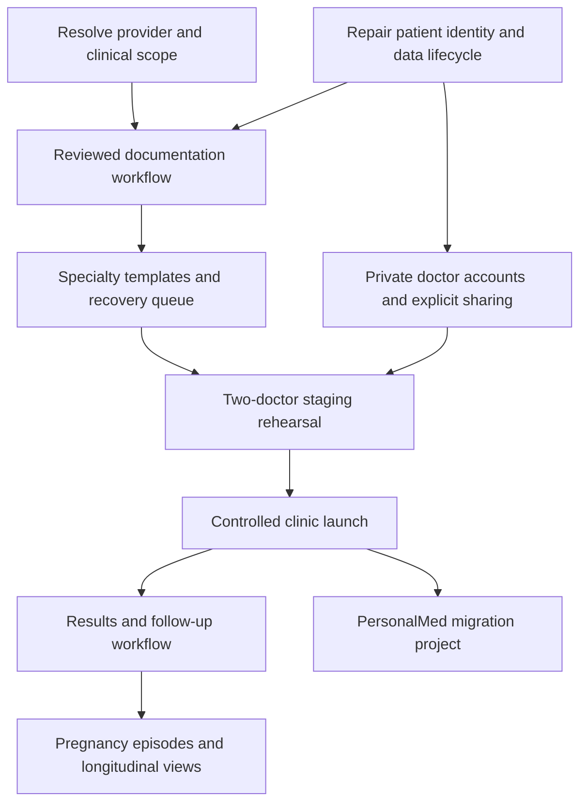

# Cortex roadmap for the Haddad Nicola launch

Proposed roadmap, 2026-10-28. This maps work; it does not authorize or implement a provider purchase, clinical rollout or patient migration.

## Confirmed product direction

All doctors will use Cortex. Each doctor has a private patient list and can explicitly share selected patients with another doctor. Clinic membership alone grants no chart access. Reception workflows are outside this first launch. PersonalMed 2005 data has been exported; inspection and migration are later work. Until a cutover decision is made, plan Cortex as an adjunct to the existing record system and define where the authoritative approved note is kept.

The clinic's public site describes gynecology, obstetrics and urology. Treat specialty workflow design as a proposal for clinic validation, not an inference about its actual visit volume or internal processes. [Clinic services](https://haddadnicola.com.br/servicos/)

## Order of delivery

S = focused slice; M = coordinated slice; L = epic to divide before implementation. These are scope estimates, not calendar promises. Sequence depends on validation and vendor decisions. No fabricated ROI score or delivery date is used.

## Launch backlog: repair and foundation

| ID | Slice | Size | Depends on | Acceptance criteria and verification |
|---|---|---|---|---|
| L01 | Select allowed AI service and narrow launch capabilities | M | None | Record exact product/terms/configuration and intended tasks. Synthetic provider smoke tests pass. AI is disabled for unsupported workflows; manual note capture remains available. See AI_PROVIDER_OPTIONS.md. |
| L02 | Make selected patient identity authoritative | S | None | URL/header/composer/snapshot/recording agree; open A→select B→query refresh stays on B; Back/Home have defined behavior. Convert UX-01 reproduction to a regression test. Likely Index + tests. |
| L03 | Preserve unknown demographics | M | None | Blank age stays unknown, actual newborn age remains 0, DOB is stored when supplied, and ages reflect the encounter date. No automatic historical0→unknown conversion without provenance. UI/API/import/schema boundary tests. Split nullable schema/type work from UI migration. |
| L04 | Make every demographic editor conflict-aware | S | L03 contract | Directory editing uses the existing revision policy, retains drafts on conflict and rejects a deleted row. Two-tab component/API tests. Likely PatientManagement + tests. |
| L05 | Keep discarded audio discoverable until cleanup succeeds | M | None | Server discard is idempotent; failed cleanup remains patient-linked and retryable. Test discard/deletion/upload races through native Storage. Separate endpoint, client integration and orphan remediation into reviewed slices. |
| L06 | Review document-derived facts before chart promotion | M | L01 | Original document and extraction shown together; accept/edit/reject recorded; rejected/unreviewed values never become authoritative chart context. Source-linked proposals + acceptance RPC + UI tests. |
| L07 | Review post-consultation history changes | S–M | L06 acceptance contract | Exact accepted history is saved; the second extraction cannot silently write new social/medical history. Invert W3 probe and test delayed/repeated acceptance. |
| L08 | Prevent identifier-bearing reusable templates | M | L01 | Generated templates enter an editable draft; source/output comparison and identifier warnings precede activation. Synthetic identifiers cannot silently become active. Template version is recorded. |
| L09 | Bind one appointment to one encounter | M | L02,L03 | Optional appointment ID persists through draft/finalization; only that appointment completes; an unscheduled encounter completes none. Invert W2 probe; enforce owned or explicitly authorized relationships. |
| L10 | Make assistant answers disclose sources and coverage | M | L01,L06 | Relevant older records can be retrieved; answers include source IDs/dates; missing retrieval is not reported as absence from the chart. Known-answer and conflicting-source evaluation. |
| L11 | Correct issuance integrity | M | None | Reject invalid certificate duration rather than clamp; store immutable issuer identity and content hash at issuance; settings changes cannot rewrite a historical manifest. Split duration validation from issuance snapshot work. |
| L12 | Bound entire operations and report integration state | M | None | Timeouts cover response bodies and cancellation; Google event creation has stable retry identity; pending/failed/synced states survive reload. Split deadline helper, outbox and UI slices. |
| L13 | Correct timeline and reminder semantics | S–M | L09 | Registration/scheduled date never appears as last completed visit; only eligible upcoming appointments receive ordinary reminders; backend matches UI. Source dates and time-zone tests. |
| L14 | Fix responsive workspace and dirty-form recovery | M | L02 | Tablet composer stays usable; one persistent identity/capture header; Back/reload/close protection consistent across editors. Test 390/768/820/1280 widths, keyboard and failure recovery. Separate layout from editor guards. |
| L15 | Complete accessibility and operational messaging | M | L14 | Text contrast≥4.5:1 where required; statuses/modes programmatic and not color-only; lookup failures distinct from empty data; copy/print failures recoverable. Automated scan plus keyboard/screen-reader checks. |

L06 and L07 use one acceptance/provenance contract but remain separately reviewable flows. L12 is an epic if it touches unrelated handlers; it should never land as one broad rewrite. Every implementation slice starts with a failing desired-behavior test for the associated defect, not the review's positive defect probes.

## Launch backlog: selective sharing

| ID | Slice | Size | Depends on | Acceptance criteria and verification |
|---|---|---|---|---|
| S01 | Named doctor accounts and clinic membership | M | Access design | Invitation/activation/offboarding; clinic admin role does not automatically reveal charts. Preserve existing owner-only behavior. Test outsider and inactive-member denial. |
| S02 | Patient read grants | M | S01 | Owner selects one doctor and patient; recipient sees “Shared with me.” All clinical tables, Storage, Edge functions and retrieval enforce the same grant. Test no sharing/no access, wrong patient, expired and revoked grants. |
| S03 | Attributed contributions | M | S02,L06,L09 | Optional contribute permission creates a new attributed encounter/addendum/proposal. Recipient cannot overwrite another author's signed/final note, re-share, export whole charts or delete records by default. Owner/author/actor remain separate. |
| S04 | Revocation during active work | M | S02,S03 | Authorization version invalidates caches; delayed AI/jobs reauthorize before saving/delivering; downloads follow documented proxy/short-TTL rules. Revoke during transcription, export, file access and tab reuse. |
| S05 | Custody, audit and account lifecycle | M | S01–S04 | Access/share/download/export actions auditable without PHI in logs; removing a doctor does not cascade-delete retained clinical contributions. Confirm custody and permissible export rules with clinic. Test offboarding and restoration. |

These are launch requirements for the requested sharing capability. If a staged release starts with sharing disabled, all doctors can still use isolated accounts; enabling sharing must wait for S01–S05. Shared logins or a broad `clinic_id` RLS allowlist are not acceptable shortcuts.

### Proposed access matrix

| Action | Owning doctor | Read recipient | Contributing recipient | Clinic administrator |
|---|---|---|---|---|
| View unshared patient | Yes | No | No | No, unless separately granted |
| View explicitly shared scope | Yes | Yes | Yes | Only with a grant |
| Add attributed clinical entry | Yes | No | Yes, within granted scope | Only if separately authorized as clinician |
| Alter another author's finalized entry | No; use amendment | No | No | No |
| Change sharing grants | Yes, subject to custody policy | No | No | Account administration alone gives no right |
| Export whole shared chart | Explicitly authorized owner operation | No | No | Separate governed operation |
| Delete retained shared record | Governed lifecycle, not ordinary editing | No | No | Separate governed operation |

Membership, `owner_user_id`, `author_user_id` and `actor_user_id` have different meanings. Existing composite ownership constraints must be evolved deliberately, not dropped to make sharing work. Permissions apply to source records and derived summaries/embeddings. Sharing a patient's chart does not authorize exposing an owner's entire knowledge library. Previously downloaded copies cannot be recalled; revocation wording must state that limit.

## Better daily functionality after the foundation

| Priority | Improvement | Why it earns a place | Minimum usable outcome |
|---|---|---|---|
| First launch | Manual typed encounter + direct draft editing | Keeps consultations usable during microphone, network or AI failures; reduces regeneration for small corrections | Autosaved physician-authored draft; edit exact final text; finalize without spending AI quota |
| First launch | Pending-work dashboard | Makes recovery discoverable | Drafts, failed uploads and awaiting-review items show patient, author, last-save time and next action |
| First launch | Gynecology, prenatal and urology templates | Fits the actual clinic; urology is currently absent | Clinician-approved templates/version per encounter; no invented negatives or measurements; preview output |
| Next | Chart timeline and revision comparison | Gives meaning to existing revision storage | Compare original/revised text and sources; filter by visit, document and contributor |
| Next | Result/referral/follow-up inbox | Prevents plans ending as untracked text | Assign owner/due date; distinguish received, reviewed and acted upon; no automatic clinical interpretation or closure |
| Next | Medication lifecycle | Makes a longitudinal list reliable | Active/changed/stopped states, dates and provenance; explicit physician reconciliation |
| Next | Versioned patient instructions | Keeps delivered text tied to approved content | Editable approved version archived before printing/sharing; channel status is truthful |
| Next | Reviewed knowledge library | Makes retrieval auditable | View source, version, review date and cited excerpt; retry indexing; retire superseded protocols |
| Later | Pregnancy episodes | Strong obstetric differentiation | Separate episodes, confirmed dating/provenance, observations and follow-up; clinician validates calculation rules |
| Later | Structured observations/trends | Supports longitudinal review without inferred facts | Values/units/date/source, correction history and consistent unit handling |
| Conditional | Verified electronic signature integration | Needed only if clinic requires this issuance workflow | Verified provider completion before signed state; immutable archive and revocation tested |
| Later | Communication confirmations and waitlist | Improves scheduling once encounter state is reliable | Channel choice, pending/sent/delivered/confirmed ledger and explicit consent/preferences |

Defer broad billing/TISS automation, a patient portal, autonomous triage, automatic drug-safety decisions, and all-purpose clinical agents until the documentation and access model has demonstrated value. These add materially different workflows and evaluation obligations.

## PersonalMed 2005: prepare now, migrate later

The export exists, but its format, schema, encoding, completeness, attachments and physician identifiers have not been inspected in this task. Do not assume it is a clean CSV or reconstruct historical clinical facts with AI.

Later migration sequence:

1. Preserve immutable originals with hashes and a protected inventory; inspect a bounded sample locally under the migration task.
2. Map legacy patient, clinician, visit and document IDs. Keep original dates, authors, source text and source-system metadata. Identify ambiguous ownership rather than assigning every record to one doctor.
3. Separate duplicate candidates from confirmed identity. Same names do not prove the same person; optional sharing is not a merge operation.
4. Run a staging dry run with row/object counts, date and encoding checks, missing attachments, unresolved relationships and a rejection report. Check clinical samples with each relevant doctor.
5. Import idempotent batches keyed by source IDs. Provide rollback of a batch without deleting later legitimate Cortex contributions. Re-running an import must not duplicate encounters or silently overwrite edited charts.
6. Agree cutover/coexistence, reconcile changes since the export, rehearse restore, and only then expand use. Do not retire PersonalMed or original exports based solely on an importer reporting success.

## Launch acceptance and measurement

- All P1 patient/context/lifecycle findings repaired and regression-tested; provider eligibility and feature scope documented.
- Two-doctor adversarial access tests pass across UI, direct API, SQL/RLS, Storage, retrieval, jobs and exports; private patient lists remain private.
- Native staging Auth/Storage/OAuth/email behavior and backup+file restore demonstrated, including failure cases. Existing local SQL suites are necessary but do not prove the hosted service configuration.
- Each doctor completes a synthetic appointment→capture/manual draft→review→approved record→document flow, plus a shared-patient contribution and revocation.
- Approved/manual fallback remains usable during provider failure; operation IDs and PHI-free diagnostics support recovery.
- Track time to approved note, editing burden, draft-recovery success, wrong-patient near misses, source-citation coverage, overdue follow-up actions, integration failures and cost per approved encounter. Establish a baseline with the clinic before setting improvement targets.

Proposed release ownership: product owner resolves scope/custody; engineering owns access, lifecycle and test evidence; clinical lead approves documentation evaluation/templates; accountable operations owner handles access, backups and incident response. Actual people and launch dates remain to be assigned.
