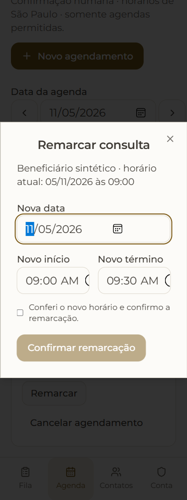

# T39/1 — auditoria inicial e horários legíveis no celular

05/11/2026. Corrigido o corte dos controles nativos de horário na remarcação e no bloqueio da agenda da recepção. Em375px, os dois campos dividiam uma linha e partes do seletor ficavam cortadas. Agora ocupam linhas próprias; em1280px permanecem lado a lado. A escala135%, valores, callbacks, validação e confirmação humana são preservados.

Somente duas classes de layout em `src/features/reception/ReceptionCalendar.tsx` foram alteradas. Não há mudança de API, agendamento, paciente, origem administrativa ou permissões.

## Evidência

- [RED](time-red/AUDIT.json): base imutável `6c90f44eb5025273da20e10340c7e5a400ab5031`, sem overlay. O teste de geometria móvel falha e registra `completed:false`, causa e limpeza confirmada.
- [GREEN focado](time-green/AUDIT.json): quatro estados de remarcação/bloqueio em375/1280px; linhas distintas no celular, mesma linha no desktop,09:00/09:30 preservados na remarcação.
- [Passagem ampla](verified/AUDIT.json):34 estados, zero erros de execução/console, sem rolagem horizontal, dialog fora do viewport, ações inacessíveis, campo sem nome/rótulo ou textoJS quebrado detectados pelos controles do ensaio. Todos os overlays/fontes/configurações conferidos e recursos próprios limpos.
- [Validação consolidada](VALIDATION.json): hashes da execução e nove testes existentes de ReceptionCalendar aprovados. Lint do TSX e do runner (Node+browser globals) e sintaxe Node aprovados.

Antes:



Depois:


| Grupo | Estados |
|---|---:|
| Login sem sessão | 2 |
| Agenda clínica, compartilhamento, trabalho, segurança, privacidade e permissões; dialog de exclusão | 14 |
| Recepção: fila, agenda, contatos, atendimento existente/novo contato e remarcação | 12 |
| Administração: equipe, correção de contato e bloqueio de horário | 6 |

## Isolamento e qualidade do ensaio

Edge/Playwright com contextos próprios,375/1280px, pt-BR e fuso São Paulo. Rede restrita às duas origens de loopback do app e de sua API sintética. Nenhuma exclusão, gravação clínica ou reserva é submetida. A reserva exibida é um seed sintético explícito da fixture.

O código textual de `src` vem do commit fixo; só o arquivo da correção entra como overlay. O loader registra as fontes efetivamente servidas. Tailwind recebe classes diretamente desse snapshot via [conteúdo raw oficial](https://v3.tailwindcss.com/docs/content-configuration#configuring-raw-content). Configs, escala e manifests precisam coincidir com a base e são conferidos ao final. Assim as edições médicas paralelas não mudam os estilos deste ensaio.

Cada app usa cache Vite temporário exclusivo, removido somente após conferir pai absoluto, prefixo, ausência de symlink e marcador de propriedade. A primeira execução compartilhando cache teve504/Outdated Optimize Dep; foi um problema do ensaio, resolvido por cache exclusivo. Não foi tratado como defeito de produção.

A revisão local independente encontrou quatro falhas no runner: reserva ausente, verificação do botão Fechar em lugar das ações, Tailwind lendo arquivos vivos e possibilidade de relatório antigo sobreviver a falha. Todas foram corrigidas: seed explícito, ações enumeradas com geometria/hit-test, estilos do snapshot, diretórios de run exclusivos e falha/resultado parcial persistidos. Capturas encerram animações para não registrar a transição translúcida. A última leitura não encontrou outro achado; revisão externa dispensada pelo usuário.

O corte interno do input nativo não aparecia no scrollWidth. A inspeção visual o encontrou; o teste novo exige a distribuição por linhas no celular e preserva os valores. Não confundir varredura automática sem achados com revisão visual completa.

## Limites e continuação

Em `/permissoes-recepcao`, a fixture clínica antiga não fornece o DTO válido desse leitor. As duas capturas verificam seu estado de erro/Atualizar, não o fluxo positivo da API. Isso está registrado em `visibleAlerts` e precisa de fixture tipada no próximo incremento; não há evidência aqui de falha do backend real.

MFA foi visitado no estado inicial, sem cadastrar fatores ou capturar segredos. Compartilhamento, gravações, cancelamentos, exclusão real, fluxos completos de erro/recuperação e RLS/Auth nativos não são aprovados por esta passagem. Não houve novo build global, typecheck das edições médicas paralelas, SQL ou teste de produção.

A entrega médica do Claude18:43 foi registrada em `f2eb189`. O [item8 foi corrigido em T39/2a](MOBILE_NAVIGATION.md): rótulos da navegação inferior separados, 37 estados e teclado verificados. O [cabeçalho em320px foi corrigido em T39/2b](CALENDAR_HEADER.md), também com37 estados. O [item6 foi corrigido em T39/2c](WEEK_CAPTION.md): legenda semanal pt-BR, 13testes e dez estados focados. Os itens1–5 e o reteste independente dos cinco arquivos seguem como próximos recortes do Codex. A proposta de unificar navegação é decisão de produto separada. T39 inteira e piloto continuam abertos.

## Reexecutar sem sobrescrever evidência

Use um nome novo para cada `--run`; diretórios existentes são recusados.

```powershell
node scripts/reception-app-audit-browser.mjs --baseline=6c90f44eb5025273da20e10340c7e5a400ab5031 --overlay=src/features/reception/ReceptionCalendar.tsx --run=recheck-1 --check-time-layout
```
