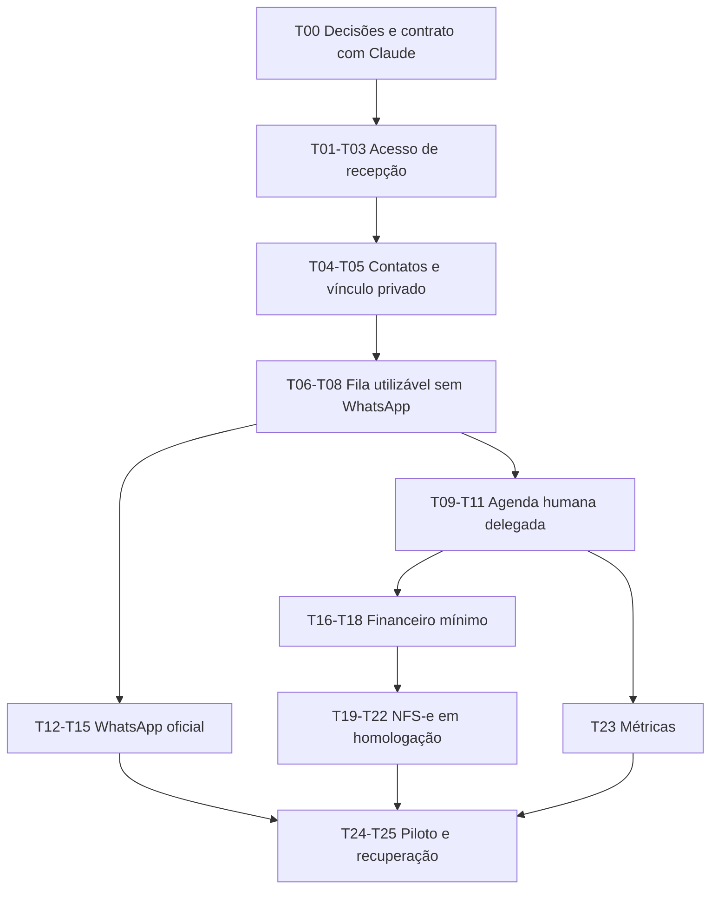

# Plano de implementação: operação da clínica

Data: 03/11/2026. Base inspecionada: `9b2adaf`. Escopo autorizado nesta etapa: pesquisa e plano da expansão do Cortex da Haddad Nicola. Não iniciar integrações reais ou migrações apenas com este documento.

Especificação: [PRODUCT_SPEC.md](../../docs/product/clinic-crm/PRODUCT_SPEC.md). Pesquisa: [MARKET_RESEARCH.md](../../docs/product/clinic-crm/MARKET_RESEARCH.md). Fiscal: [FISCAL_FEASIBILITY.md](../../docs/product/clinic-crm/FISCAL_FEASIBILITY.md). Interface com o trabalho do Claude: [DATABASE_HANDOFF.md](../../docs/product/clinic-crm/DATABASE_HANDOFF.md). Tarefas executáveis: [todo.md](todo.md).

Os arquivos raiz `tasks/plan.md` e `tasks/todo.md` já têm alterações e apontamentos do produto SaaS; foram preservados. Esta pasta é o plano específico da clínica.

## Resultado esperado

Secretárias trabalham em fila e agenda compartilhadas dentro dos seus escopos, reconhecem contatos com confirmação de identidade, recebem sugestões administrativas de médico e confirmam pessoalmente as reservas. Depois do atendimento, equipe autorizada registra serviços/recebimentos e acompanha a NFS-e autorizada, sem expor o prontuário aos demais papéis.

## Decisões de estrutura

1. Evoluir o app React/Supabase/PostgreSQL existente por módulos; não criar outro produto nem substituir os prontuários atuais.
2. Contato administrativo da clínica e prontuário médico são objetos separados, ligados por identificadores e permissões.
3. Autorização por capacidade e escopo médico/fila, validada no servidor. Rever caminhos de compartilhamento existentes ao incluir novos papéis.
4. Filas concorrentes com responsável atual, revisão, histórico e transferências. Regras simples antes de IA.
5. Agendamento é uma transação com ator humano, validação de delegação e conflito. Sistema sugere; pessoa decide.
6. Adaptadores oficiais para WhatsApp e NFS-e; mensagens/notas com idempotência e reconciliação. APIs não podem controlar a autorização do produto.
7. Financeiro mínimo precede emissão fiscal: serviços, cobranças e pagamentos não compartilham um único status.
8. Staging PersonalMed separado; alinhar mapa de IDs e propriedade antes de backfill dos vínculos administrativos.

## Sequência e dependências

As frentes WhatsApp e agenda podem avançar em paralelo após contratos estáveis, se houver equipe. Migrações e alterações de autorização compartilhada precisam de coordenação sequencial. Claude pode continuar extração e diagnóstico do legado enquanto usamos dados sintéticos; não executar duas migrações finais ao mesmo tempo.

## Entregas incrementais

| Entrega | Tarefas | Aceite do incremento |
|---|---|---|
| 0 — Contrato de operação/dados | T00 | Escopos, identidade, decisões fiscais e responsabilidades explicitados; dúvidas localizadas |
| 1 — Recepção utilizável | T01–T08 | Conta restrita, contatos, fila manual, assumir/transferir e sugestão de médico sem acesso clínico |
| 2 — Agenda da equipe | T09–T11 | Secretária agenda para profissional autorizado; conflito simultâneo tratado; lembretes não usam reservas antigas |
| 3 — WhatsApp real | T12–T15 | Número de teste, recebimento/envio, reconexão, janela/modelos e entrega verificáveis; reserva continua humana |
| 4 — Financeiro operacional | T16–T18 | Serviços e recebimentos separados, parcial/estorno e dados do tomador revisáveis |
| 5 — Fiscal | T19–T22 | Cenários de homologação aprovados pelo contador; nota não duplica após timeout; arquivos/estados reais |
| 6 — Piloto | T23–T25 | Métricas, permissões, recuperação, suporte e rollout exercitados com equipe pequena |

Primeiro checkpoint após T03: provar acesso por API/SQL, inclusive tentativas de contornar a tela. Segundo após T08: demonstrar duas secretárias e um contato familiar. Terceiro após T11: demonstrar disputa de horário, remarcação e queda de sincronização. Quarto após T15: indisponibilidade/replay e opt-out. Quinto após T22: retorno fiscal perdido, rejeição e cancelamento. Piloto só após critérios de segurança e reconciliação.

## Esforço inicial

Estimativa própria de engenharia para uma pessoa desenvolvedora experiente, com suporte pontual da clínica e contador. Não é prazo contratado, produtividade garantida de IA nem uma estimativa da migração do PersonalMed. Considera testes e recuperação; não inclui tempo de espera por Meta, fornecedor fiscal, certificado, contratos ou validação externa.

| Bloco | Dias de trabalho |
|---|---|
| Acesso, contatos e fundação da recepção | 8–12 |
| Fila completa e agenda humana delegada | 7–12 |
| WhatsApp oficial | 8–12 |
| Financeiro mínimo | 6–10 |
| NFS-e via integrador, após financeiro | 10–18 |
| Métricas, recuperação e piloto | 5–8 |
| Total para o conjunto inicial | 44–72, aproximadamente 9–15 semanas |

Primeira recepção/agenda manual: aproximadamente 15–24 dias de trabalho. Financeiro + fiscal: 16–28 dias. Integração fiscal direta é alternativa de maior esforço, descrita no estudo fiscal; não somar ao integrador. Reestimar após T00 e as provas de WhatsApp/fiscal. Mudança importante de schema, múltiplos CNPJs ou agenda legada pouco confiável altera estas faixas.

## O que pode avançar sem os fornecedores

Tela e contratos da recepção, capacidades, fila manual, cadastro administrativo, simulações de concorrência, agenda humana delegada, serviços/cobranças e adaptadores falsos de teste. Nenhum botão deve sugerir que o WhatsApp ou a nota foi enviado quando está em simulação.

Dependem de resposta do Claude: vínculos confiáveis do legado e backfill real. Dependem da clínica: contas, divisão da equipe, agendas e número do canal. Dependem do contador: regime/classificação/momento de emissão. Dependem de contrato e acessos: produção WhatsApp/fiscal e eventual gateway externo.

## Riscos concretos e mitigação

| Risco | Resposta planejada |
|---|---|
| Novo papel administrativo consegue entrar em RPC clínica antiga | Inventariar todas as verificações de membro, testar acesso negado e capacidade clínica explícita |
| Telefone de família/reutilizado liga paciente errado | Candidatos e confirmação humana, canal separado de pessoa |
| Duas secretárias agem sobre o mesmo caso/horário | Revisão, idempotência, locks/constraint adequados e erro de conflito útil |
| Migração paralela redefine propriedade ou duplica pacientes | Staging, mapa de origem e um executor de schema/corte |
| Provedor processa mas retorno se perde | Consulta pela mesma referência e reconciliação; nunca novo pedido automático |
| Servidor local ou internet indisponível | Gateway/HTTPS decidido antes do piloto, filas duráveis, atraso visível e procedimentos de recuperação |
| “Integração” promete nota correta sem configuração fiscal | Validar exemplos com contador, versionar regras e separar autorização técnica de obrigação fiscal |

## Finalização futura

Só marcar implementação concluída quando as tarefas e checkpoints correspondentes passarem. Pesquisa de mercado e telas simuladas não substituem homologação. Não marcar emissão fiscal/WhatsApp em produção concluídos com respostas mockadas.

Para uma publicação futura: backup e ensaio de migrations, ativação por capacidade/feature flag, piloto com uma equipe e escopos limitados, monitoramento, canal de suporte e rollback que preserve mensagens/notas já aceitas externamente. O serviço antigo continua com custódia e histórico durante o corte.
